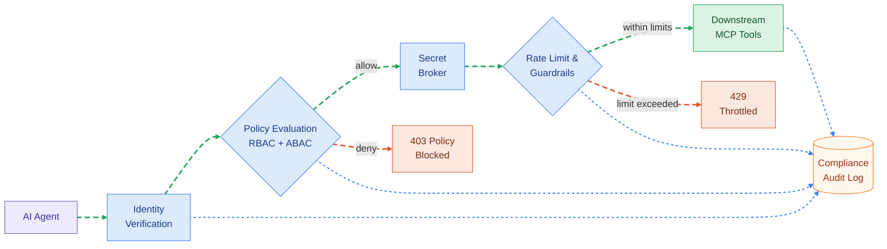

# MCP Gateway with AI Governance

### Architecture & AI Governance Brief

*For engineering leadership and enterprise clients evaluating the security, compliance and reliability of our AI agent platform. Companion visual: [`mcp_gateway_diagrams.html`](./mcp_gateway_diagrams.html).*

---

> **Key Takeaways for Leadership & Clients**
>
> - **Raw MCP connects, but it does not govern.** Direct agent-to-tool connections spread credentials, over-grant permissions and leave no single audit trail, which blocks production approval in regulated environments.
> - **One gateway governs every tool call.** Each agent request is verified, authorized, credential-brokered, rate-limited and logged before it reaches a downstream system, so every action is attributable, bounded and reviewable.
> - **Adopt the foundation, own the policy.** Building on a proven gateway core with custom policy hooks delivers production-grade controls in weeks rather than quarters, while keeping the business-specific rules under our control.

---

## 1. Executive Summary

The Model Context Protocol (MCP) has quickly become the standard way for AI agents to reach databases, internal APIs and SaaS applications. It solves connectivity well. It was not designed to solve enterprise control. In a direct agent-to-tool topology, every agent carries its own credentials, every tool server enforces its own permissions (or none), and no single record shows what an agent did and on whose behalf.

That is workable in a pilot. At enterprise scale it creates four gaps that security, risk and compliance teams will not sign off on:

- **Credential sprawl:** long-lived API keys and tokens are copied into agent configurations, where they are hard to rotate and easy to leak.
- **Over-broad tool permissions:** agents inherit whatever a shared service account can do, far beyond the task in front of them.
- **Prompt-injection blast radius:** a manipulated agent can call any tool its credentials reach, so one malicious document can become a data-exfiltration path.
- **No auditability:** tool calls are scattered across server logs with no consistent identity, decision or correlation, which makes incident response and audit evidence slow and incomplete.

The **MCP Gateway** closes these gaps by placing a single policy enforcement point between every agent and every tool. Agents connect to one governed endpoint. The gateway verifies identity, evaluates policy, brokers short-lived credentials, applies rate limits and guardrails, and writes a tamper-evident audit record before any request is forwarded. For our clients, this turns "trust our agents" into "verify our controls": the same evidence their security teams expect from any other production system.

## 2. Live Architecture & Request Lifecycle

Every agent request follows the same governed path. Each checkpoint can stop the request, and every decision, whether allow or deny, is recorded.

1. **Identity verification:** the agent presents a cryptographically verifiable workload identity, together with the delegated context of the human or service it acts for. Unverified callers are rejected at the edge.
2. **Policy evaluation (RBAC + ABAC):** the policy engine combines role-based rules with attributes such as tool, operation, data classification, tenant, environment and request risk. The default is deny, and policies are versioned as code.
3. **Secret brokering:** the gateway obtains a short-lived, narrowly scoped credential from the vault and attaches it at dispatch, only after every check has passed. The agent never sees it.
4. **Rate limiting and guardrails:** quotas apply per agent, per user and per tool. Inputs and outputs are inspected, and high-impact operations pause for human approval.
5. **Tool execution:** the request is forwarded to the downstream MCP server, and the response is filtered (for example, sensitive-field redaction) before it returns to the agent.
6. **Compliance auditing:** each stage emits a structured event, correlated by a single trace ID, to an append-only audit log that exports to the client's security monitoring tools.

The flow below shows the three outcomes: **green** for allowed traffic, **red** for blocked or throttled requests, and **blue** for audit events.

*The dashed lines animate in Mermaid 11 renderers. Some Markdown previews, including GitHub's, may show them static; the interactive page shows the same flow with live packets.*

## 3. Core AI Governance Pillars

### 3.1 Zero-Trust Identity & Fine-Grained Access Control

- **Every caller is authenticated, every time:** there is no implicit trust based on network location, and agents use short-lived, verifiable identities rather than shared keys.
- **Delegation is explicit:** each request carries both the agent's identity and the identity of the user it acts for, so an agent can never exceed the rights of its requester.
- **Permissions are scoped to the operation:** policies grant access to specific tools and actions (read a record, not administer a system), with data classification and tenant boundaries enforced on every call.

### 3.2 Vault-Backed Credential Brokering (Zero Secret Exposure)

- **Agents hold no secrets:** downstream credentials live only in the vault and are attached by the gateway at the moment of dispatch.
- **Credentials are short-lived and least-privilege:** each one is minted for a single tool and scope, expires within minutes and is revoked automatically.
- **Rotation without disruption:** because agents never store credentials, rotating or revoking a key is a vault operation, not a redeployment.

### 3.3 Guardrails, Rate Limits & Human-in-the-Loop Controls

- **Quotas contain runaway behavior:** per-agent, per-user and per-tool limits stop loops, scraping and cost spikes before they reach a downstream system.
- **Content guardrails inspect both directions:** requests are screened for injection patterns and policy violations, and responses are filtered for sensitive data before they return to the model.
- **People approve high-impact actions:** writes, deletions, payments or bulk exports can be routed to a named approver, with the decision captured in the audit trail.

### 3.4 End-to-End Auditability & Compliance Readiness

- **One correlated record per request:** identity, policy version, decision, tool, latency and outcome are logged under a single trace ID.
- **Tamper-evident retention:** audit events are append-only and integrity-protected, with retention configurable to each client's obligations.
- **Evidence mapped to frameworks:** the controls produce evidence that supports access-control, logging and change-management requirements under **SOC 2**, **HIPAA**, **GDPR** and **ISO 27001**. The gateway strengthens a client's compliance posture; certification remains an outcome of their wider control program.

### Security Risk → Governance Control → Business Outcome

| Security Risk | Governance Control | Business Outcome |
|---|---|---|
| Credential sprawl across agents | Vault-backed brokering of short-lived, scoped credentials | No standing secrets to leak; rotation without downtime |
| Over-broad tool permissions | Default-deny RBAC + ABAC on every tool and operation | Least privilege that a client's security team can verify |
| Prompt-injection blast radius | Delegated identity, operation-level scopes, content guardrails | A compromised prompt reaches only what the user was already allowed |
| Runaway or abusive agent loops | Per-agent, per-user and per-tool rate limits with circuit breaking | Predictable cost and protected downstream systems |
| Unreviewed high-impact actions | Human-in-the-loop approval for sensitive operations | Accountable automation with a named approver |
| Missing or fragmented audit trail | Append-only, trace-correlated audit log with security-tool export | Faster incident response and audit-ready evidence |

## 4. Strategic Approach: Build vs. Adopt

Every enterprise eventually needs the same gateway fundamentals: protocol handling, identity integration, routing, quotas and logging. These are hard to build well and do not differentiate the business. What does differentiate it is the policy: which agents may touch which data, under what conditions and with whose approval. Our recommendation is to **adopt a proven gateway foundation and invest our engineering in custom policy hooks**.

| Dimension | Build from Scratch | Adopt Foundation + Custom Policy Hooks |
|---|---|---|
| Time to production | Two to three quarters before core controls are hardened | Weeks to a governed pilot; custom policies layered in incrementally |
| Security assurance | Every control must be designed, tested and pen-tested from zero | Core controls are already field-tested; review focuses on our policy layer |
| Protocol evolution | Team must track and implement each MCP specification change | Foundation absorbs specification changes; we validate and upgrade |
| Operational risk | Single team owns availability, scaling and on-call for all of it | Shared maturity on the core; our team owns a smaller surface |
| Differentiation | Engineering effort spent on commodity plumbing | Effort focused on business-specific policy, approvals and reporting |
| Total cost of ownership | High and front-loaded, with long-term maintenance burden | Lower and predictable, with spend tied to value-adding work |

- **Selection criteria stay vendor-neutral:** any foundation we adopt must be open-standards based, support pluggable policy-as-code, expose full audit events and run in the client's chosen environment.
- **Lock-in is managed by design:** policies, audit schemas and identity integrations are kept in portable formats, so the foundation can be replaced without rewriting governance.

## 5. Phased Implementation Roadmap

The rollout is staged so that each phase delivers usable controls and the evidence needed to approve the next.

| Phase | Indicative Timeline | Scope | Exit Criteria |
|---|---|---|---|
| **1. Foundation** | Weeks 0–6 | Gateway deployed in front of two or three priority tools; workload identity; default-deny baseline policies; vault brokering; central audit log | All pilot agent traffic flows through the gateway; no agent holds a downstream secret |
| **2. Governance & Controls** | Weeks 6–14 | ABAC with data classification; rate limits and circuit breakers; content guardrails; human-in-the-loop approvals; security-tool export | Policies managed as versioned code; approvals live for high-impact actions; audit evidence reviewed by security |
| **3. Enterprise Scale** | Weeks 14–26 | Multi-tenant and multi-region operation; self-service tool onboarding; compliance reporting packs; resilience and failover testing | Gateway is the only approved path for agent tool access; client-facing compliance evidence available on request |

- **Value arrives in Phase 1:** removing standing secrets and centralizing audit closes the highest-risk gaps first.
- **Each phase earns the next:** exit criteria are measurable, so leadership and clients can verify progress rather than take it on trust.
- **Adoption scales safely:** by Phase 3, onboarding a new tool is a policy change rather than a security project.

## Next Steps

- **Confirm pilot scope:** agree on the first two or three tools and the agent use cases they serve.
- **Align on policy owners:** name the business and security owners who approve access rules and high-impact actions.
- **Review the interactive walkthrough:** open [`mcp_gateway_diagrams.html`](./mcp_gateway_diagrams.html) to see authorized, blocked and rate-limited requests move through the gateway step by step.
